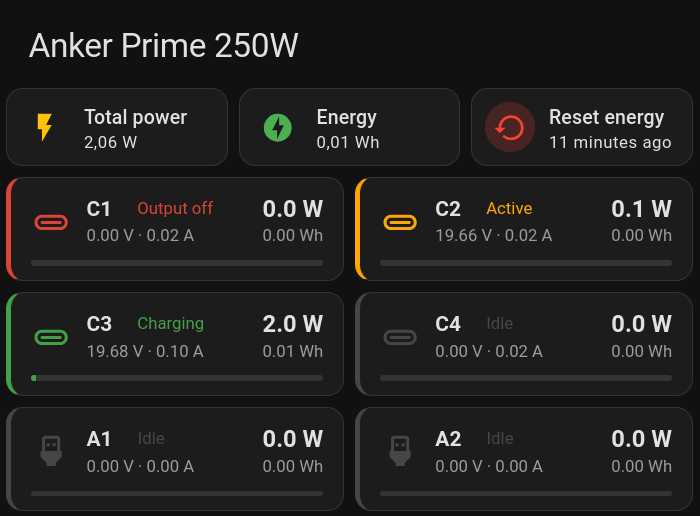
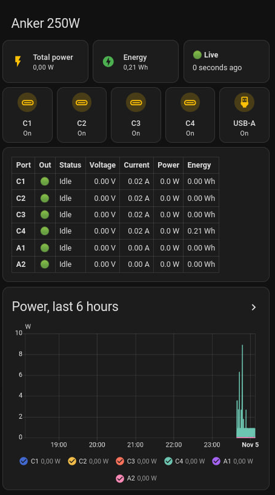

# Anker Prime for Home Assistant

Home Assistant integration for Anker Prime chargers, built on the
[anker-prime-driver](https://github.com/didim99/anker-prime-driver) library.

> **Status: pre-alpha, under development.** The 250W works through the Anker
> cloud. The 160W works over Bluetooth in tests but has not been tried on a
> real charger yet.

This is an unofficial project, not affiliated with or endorsed by Anker.

## Supported chargers

| Model | Name                     | Connection                              | Notes                                       |
|-------|--------------------------|-----------------------------------------|---------------------------------------------|
| A2345 | Anker Prime Charger 250W | Anker cloud (account + MQTT over Wi-Fi) | needs the charger bound in the Anker app    |
| A2687 | Anker Prime 160W         | Bluetooth LE (local adapter or proxy)   | not tested on real hardware                 |

Requires Home Assistant 2026.1 or later.

## Features

- **Setup in the UI**, two ways (Add integration → Anker Prime):
  - **Anker account** (250W): sign in, choose the chargers; one device per
    charger, all sharing one connection. A second Anker account, with the
    chargers shared to it, keeps the Anker app's own login untouched.
  - **Bluetooth** (160W): discovered automatically, or picked from the
    chargers nearby; one entry per charger. See [160W over
    Bluetooth](#160w-over-bluetooth).
- **Sensors:** power, voltage, current and status (idle, active, charging;
  cable, protocol and device as attributes) per port; total power; energy per
  port and in total for the energy dashboard; when each output's countdown
  ends.
- **Switches:** power per output; preferred outputs of the port-priority mode;
  clock screensaver, holiday themes, max compatibility, device
  identification, UFCS; display auto-rotation (160W).
- **Selects and numbers:** charging mode, screen timeout, knob direction, hour
  format, clock theme, display brightness; on the 160W also fixed
  allocation, screen orientation and display language (the charger does not
  report the last two, so they read unknown until set from Home Assistant).
- **Buttons:** refresh the settings; reset the energy counters (disabled by
  default).
- **Binary sensors:** over-temperature and output faults; "port charging"
  (disabled by default).
- **Actions** on the output switches: `anker_prime.set_schedule`,
  `anker_prime.disable_schedule`, `anker_prime.start_countdown`,
  `anker_prime.cancel_countdown`; on the clock screensaver switch:
  `anker_prime.set_clock_schedule`. Output switches show their schedules and
  countdown as attributes.
- **Options:** the minimum interval between entity updates (default 5 s; 0
  updates on every reading, about once a second). Energy is counted from
  every reading either way and kept across restarts.
- Re-authentication when Anker stops accepting the login, a repair notice
  when a charger stays offline for 30 minutes, and diagnostics with secrets
  removed.
- **Languages:** English and Russian.

Features the library has not confirmed on real hardware yet are disabled by
default; enable them on the entity page to try them. Entities appear only for
what the charger model offers.

## 160W over Bluetooth

Needs Home Assistant's Bluetooth integration with a connectable adapter, or an
ESPHome Bluetooth proxy, in range of the charger. Home Assistant offers newly
seen chargers on the integrations page; otherwise add one by hand and choose
**Bluetooth**.

- **Access check:** setup connects once and reads the charger's serial. Newer
  firmware only accepts the Anker account the charger is bound to: enter that
  account's user ID as the owner account ID (prefilled from a configured
  Anker account; the library's CLI prints it after `ankerprime login`).
  Without it such a charger refuses the session and setup says so. If the
  charger starts refusing later, Home Assistant asks for the owner ID again.
- **One connection at a time:** while Home Assistant holds the connection,
  the Anker app cannot reach the charger. Close the app before setting it up.
- **Options:** keep the connection open (default; live readings about once a
  second), or connect only for each read (every 60 s by default, 30–3600 s)
  and each command, which leaves room for the app in between. Energy between
  reads up to two minutes apart is interpolated; longer gaps count nothing.
- **Offline notice:** a repair notice appears when no readings arrive for 30
  minutes.

## Dashboard examples

Two ready-made port monitors for a 250W. Paste a file into a dashboard
(Edit dashboard → Add card → Manual). Entity IDs follow the device name; the
examples use a device named "250W Prime", so replace the `250w_prime_`
prefix with yours (see any entity's settings for its ID).

### Port cards with button-card

[`docs/cards/ports-button-card.yaml`](docs/cards/ports-button-card.yaml)
needs [button-card](https://github.com/custom-cards/button-card) (HACS,
version 4). One card per port shows its status, power, voltage, current and
energy, with a bar for power against the port's maximum; color shows the
state (charging, active, idle, output off). Tap a port for its power history,
hold it for the output switch with schedules and countdown. Above them: total
power, total energy and a reset button (it asks before resetting); below:
output switches and a power graph.



### Core cards only

[`docs/cards/ports-core-cards.yaml`](docs/cards/ports-core-cards.yaml) needs
nothing extra: tiles for total power, energy and whether the charger is live,
a button per output, a table of all ports and a power graph.



## Installation

Requires Home Assistant 2026.1 or later. Home Assistant installs the
[anker-prime-driver](https://pypi.org/project/anker-prime-driver/) library
itself, in the exact version the integration pins.

**HACS (custom repository):**

1. HACS → ⋮ → Custom repositories: add
   `https://github.com/didim99/ha-anker-prime`, type **Integration**.
2. Find **Anker Prime** in HACS, download it and restart Home Assistant.
3. Add it under Settings → Devices & services → Add integration → Anker
   Prime.

**Manually:** copy `custom_components/anker_prime/` to
`/config/custom_components/`, restart Home Assistant and add the integration
as above.

The integration also loads Home Assistant's Bluetooth integration, which the
160W needs; without a Bluetooth adapter it simply stays idle.

### Unreleased library versions

To try library changes before they are on PyPI, build a wheel
(`python -m build` in `anker-prime-driver`), copy it to `/config/wheels/` and
point the manifest's requirement at it, locally only:

```json
"requirements": ["anker-prime-driver[ble] @ file:///config/wheels/anker_prime_driver-0.7.4-py3-none-any.whl"]
```

Every rebuilt wheel needs a new version: Home Assistant hands the requirement
to `uv` on every start, and `uv` skips a version that is already installed.
Pre-releases (`0.7.4rc1`) published to PyPI work with an exact pin as well.

## Development

Tests run in Docker, against the oldest supported and the newest Home
Assistant. The library working copy is expected next to this repository
(`../anker-prime-driver`); set `LIBRARY_PATH` to use another location.

```bash
docker compose build
docker compose run --rm test-min        # Home Assistant 2026.1, Python 3.13
docker compose run --rm test-latest     # newest Home Assistant, Python 3.14
docker compose run --rm library-latest  # library test suite on Python 3.14
```

Each run installs the library from a fresh copy of its working tree, then runs
`ruff check`, `mypy` and `pytest`; extra arguments go to pytest
(`docker compose run --rm test-min -k flow`). Both repositories are mounted
read-only, so runs leave no files behind. `test-latest` follows the newest
`pytest-homeassistant-custom-component` release each time its image is rebuilt
(`docker compose build --no-cache test-latest`); the first line of every run
shows the versions in use. A test checks that the manifest pins exactly the
library version under test: after changing the library, publish it and move
the pin together.

Formatting and import order follow the project codestyle by hand; `ruff check`
verifies line length and common lint rules.

## Credits

The protocol knowledge comes from [Charker](https://github.com/qzz0518/Charker)
by qzz0518 (MIT), through the `anker-prime-driver` library.

## License

MIT — see [LICENSE](LICENSE). Anker trademarks belong to their owner.
